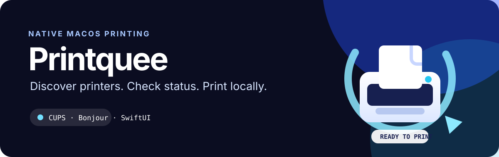

<p align="center">
  
</p>

<p align="center">
  <a href="#features">Features</a> ·
  <a href="#build">Build</a> ·
  <a href="#roadmap">Roadmap</a>
</p>

# Printquee

Printquee is a small, native macOS menu-bar utility for discovering and checking printers through CUPS and Bonjour/AirPrint.

It is designed as a modern, local-first alternative to legacy printer helper apps: no account, no license server, no privileged daemon.

## Features

- Shows printers configured in macOS through CUPS
- Discovers IPP/AirPrint services on the local network via Bonjour
- Displays printer source and status in a compact menu-bar panel
- Sends a test page to configured CUPS printers
- Runs as a user-space SwiftUI app
- Includes no licensing, account, cloud, or privileged helper layer

## What it looks like


The current release is an MVP. A Bonjour-discovered printer is shown immediately; to print to it, add it once in **System Settings → Printers & Scanners**.

## Build

The project is a native Swift package. With a full Xcode installation:

```sh
swift build -c release
```

For a direct local build using the Command Line Tools:

```sh
swiftc -parse-as-library \
  -swift-version 5 \
  -target arm64-apple-macosx13.0 \
  -framework AppKit \
  -framework Foundation \
  -framework SwiftUI \
  Sources/HandyShare/main.swift \
  -o .build/manual/Printquee
```

## Security and privacy

Printquee only talks to local macOS printing services and local Bonjour printer discovery. It does not upload documents, contact a licensing service, or install a root/helper component.

Before public distribution, the release should be signed with Developer ID, hardened, and notarized by Apple.

## Roadmap

- Add a native “Add printer” flow for discovered AirPrint devices
- Add a printer detail view with queue and error information
- Build a universal Apple Silicon + Intel release
- Add signed, notarized distribution and update checks

## Attribution

Made with ♥ in Cologne by [ekrem.eu](https://ekrem.eu).

## License

License terms will be added before the first public release.
